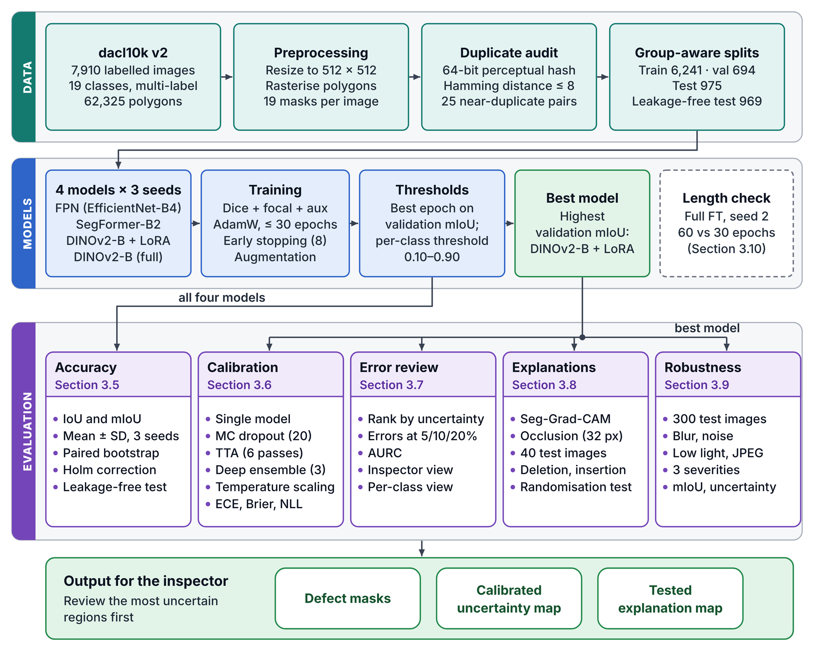
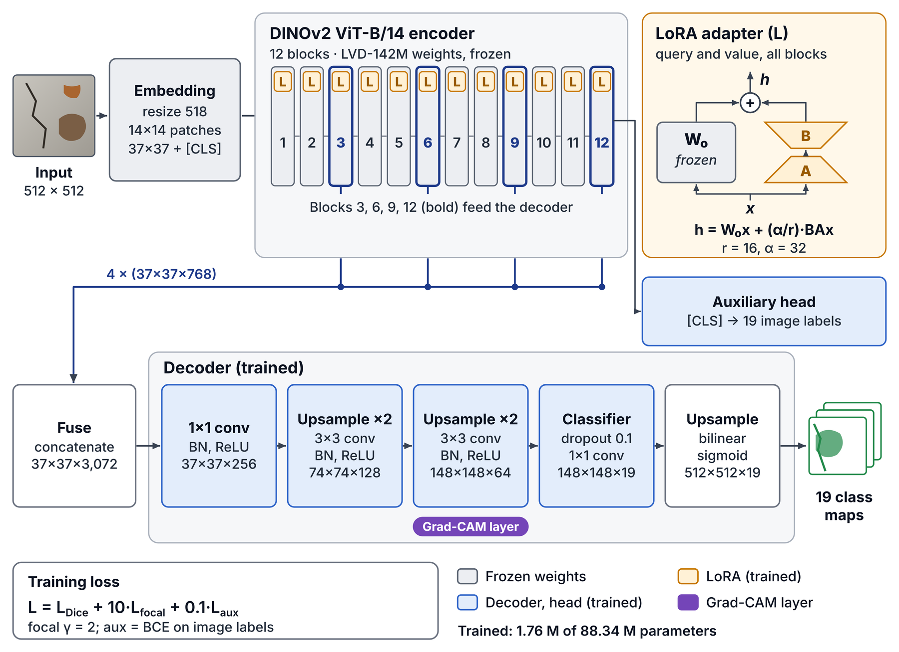

# Trustworthy multi-label bridge damage segmentation on dacl10k

Companion code for the manuscript:

> M. Ali, U. Nasir, *Beyond accuracy: calibrated uncertainty, faithful explanations and robustness for multi-label bridge damage segmentation on dacl10k*. Citation details will be added on publication.

The study evaluates bridge damage segmentation beyond accuracy. Four models are trained on the 19-class, multi-label dacl10k dataset and the best model is then tested for calibration, uncertainty-guided error review, explanation faithfulness and robustness to image corruption.

## Main results

Test mIoU (mean ± standard deviation over three seeds; per-class thresholds tuned on the validation split):

| Model | Trainable parameters | Test mIoU | Leakage-free test mIoU |
|---|---|---|---|
| FPN (EfficientNet-B4) | 19.36 M | 0.387 ± 0.004 | 0.386 ± 0.004 |
| SegFormer-B2 | 27.37 M | 0.410 ± 0.002 | 0.409 ± 0.002 |
| **DINOv2-B + LoRA** | **1.76 M of 88.34 M** | **0.437 ± 0.008** | **0.436 ± 0.008** |
| DINOv2-B (full fine-tuning) | 87.75 M | 0.376 ± 0.041 | 0.376 ± 0.041 |

- DINOv2-B + LoRA outperformed every other model in paired bootstrap tests (5,000 resamples, Holm-adjusted p < 0.001).
- A three-model deep ensemble with per-class temperature scaling gave the best calibration (ECE on active pixels 0.1270, against 0.2955 for the uncalibrated single model).
- Reviewing the 10% most uncertain pixels located 29–30% of all pixel errors.
- Seg-Grad-CAM and occlusion explanations passed deletion, insertion and model-randomisation tests.
- Under blur, noise, low light and JPEG compression, mIoU fell by up to about 45%, but the model's uncertainty did not rise.

All tables reported in the paper are in [`results/`](results/).

## Repository contents

| Path | Content |
|---|---|
| `notebooks/dacl10k_trustworthy_segmentation.ipynb` | The complete experiment: data download and audit, training, evaluation, all tables and figures |
| `notebooks/dacl10k_trustworthy_segmentation_executed.ipynb` | The same notebook with the outputs of the final run that produced the paper's results (read-only record) |
| `results/` | The paper's tables as CSV files |
| `docs/` | Workflow and architecture diagrams |
| `requirements.txt` | Python packages |
| `CITATION.cff` | Citation information |
| `LICENSE` | MIT licence for the code |

## Data

The notebook downloads dacl10k automatically. The images and annotations are **not** included in this repository.

- dacl10k is released by its authors under the **CC BY-NC 4.0** licence (non-commercial use only). Please cite the original dataset paper: J. Flotzinger, P.J. Rösch, T. Braml, dacl10k: Benchmark for semantic bridge damage segmentation, in: Proceedings of the IEEE/CVF Winter Conference on Applications of Computer Vision (WACV), 2024.
- The official archive link listed in the [dacl10k-toolkit](https://github.com/phiyodr/dacl10k-toolkit) did not work when the experiments were run, so the notebook falls back to the Hugging Face mirror [`Voxel51/dacl10k`](https://huggingface.co/datasets/Voxel51/dacl10k). It can also use a copy of `dacl10k_v2_devphase.zip` placed in your Google Drive project folder.
- The official training split is divided into training (6,241 images) and validation (694 images) with near-duplicate groups kept together (64-bit perceptual hash, Hamming distance ≤ 8). The official validation split (975 images) is the test set; a leakage-free test set (969 images) excludes test images with a near-duplicate in the training data.

## How to run

The notebook is written for **Google Colab** with a GPU. The final run of the paper used an NVIDIA A100-SXM4-40GB.

1. Open `notebooks/dacl10k_trustworthy_segmentation.ipynb` in Colab (one browser tab only).
2. Select **Runtime → Change runtime type → GPU**.
3. Recommended first step: set `SMOKE_TEST = True` in CELL 04 and choose **Runtime → Run all**. This dry run uses synthetic images and checks every cell in a few minutes.
4. Set `SMOKE_TEST = False` and choose **Runtime → Run all**.

Results are saved to Google Drive under `MyDrive/dacl10k_project/` (`splits/`, `runs/`, `results/`, `tables/`, `figures/`). Training is resumable: after a disconnection, run all cells again and finished runs are skipped. Training all 12 runs (4 models × 3 seeds) from scratch needs many GPU hours.

| Switch | Paper setting | Cell | Meaning |
|---|---|---|---|
| `SMOKE_TEST` | `False` | CELL 04 | `True` = dry run on synthetic data |
| `E1_SEEDS` | `[0, 1, 2]` | CELL 21 | Seeds trained for each model |
| `RUN_EPOCH_CHECK` | `True` | CELL 26b | Training-length check (60 vs 30 epochs) |
| `RUN_E2` | off | CELL 26 | Optional resolution study, not reported in the paper |
| `RELEASE_GPU_AT_END` | `True` | CELL 38 | Disconnects the runtime when all cells have finished |

**Output numbering.** Tables 1–9 match the paper. The notebook numbers the supplementary tables S1, S2, S4 and S5; in the paper they are Tables S1, S2, S3 and S4. Figures S1–S3 match the paper. Main figures: the notebook's Figures 2, 3 and 4–9 are the paper's Figures 2, 3 and 5–10; the notebook's Figure 1 (overview) is not used in the paper. Paper Figure 1 (workflow) and Figure 4 (model architecture) are in `docs/`.

## Experimental settings

| Setting | Value |
|---|---|
| Input size | 512 × 512 (DINOv2 inputs resized to 518 × 518) |
| Loss | Dice + 10 × focal (γ = 2) + 0.1 × auxiliary BCE |
| Optimiser | AdamW; learning rate 3 × 10⁻⁴ (new layers and LoRA), 5 × 10⁻⁵ (pretrained encoders); weight decay 10⁻⁴ |
| Schedule | Batch size 8; 2 warm-up epochs, then cosine decay; up to 30 epochs; early stopping with patience 8 |
| LoRA | Rank 16, alpha 32, dropout 0.1, on the query and value projections |
| Seeds | 0, 1, 2 |
| Thresholds | Per class, grid 0.10–0.90 in steps of 0.05, tuned on validation |
| Statistics | Paired bootstrap, 5,000 resamples of test images, Holm correction |
| Uncertainty | Single model; MC dropout (20 passes); test-time augmentation (6 passes); deep ensemble (3 seeds); per-class temperature scaling |
| Robustness | 300 test images; blur, noise, low light, JPEG; 3 severities |

## Software

Package versions recorded in the final run: torch 2.14.1 (CUDA 13.0 build), segmentation-models-pytorch 0.6.0, transformers 5.22.1, peft 0.21.2, albumentations 2.0.8, matplotlib 3.10.0. The remaining packages were the versions preinstalled in Google Colab at the time. CELL 37 of the notebook writes the full environment to `results/environment.json`.

## Citation

If you use this code, please cite the archived code release (https://doi.org/10.5281/zenodo.24501005), the paper (details will be added on publication) and the dacl10k dataset. See `CITATION.cff`.

## Licence

The code is released under the MIT licence. The dacl10k data, and models trained on it, are subject to the dataset's CC BY-NC 4.0 licence.

## Contact

Mehar Ali (corresponding author), Riphah Institute of Systems Engineering, Riphah International University, Islamabad, Pakistan. E-mail: alimehron@gmail.com
